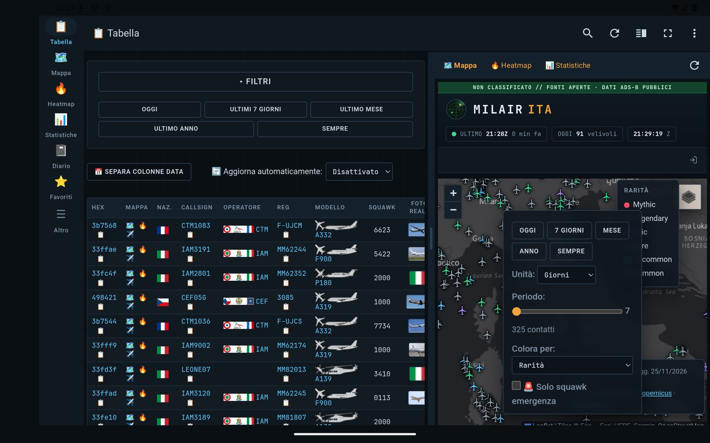
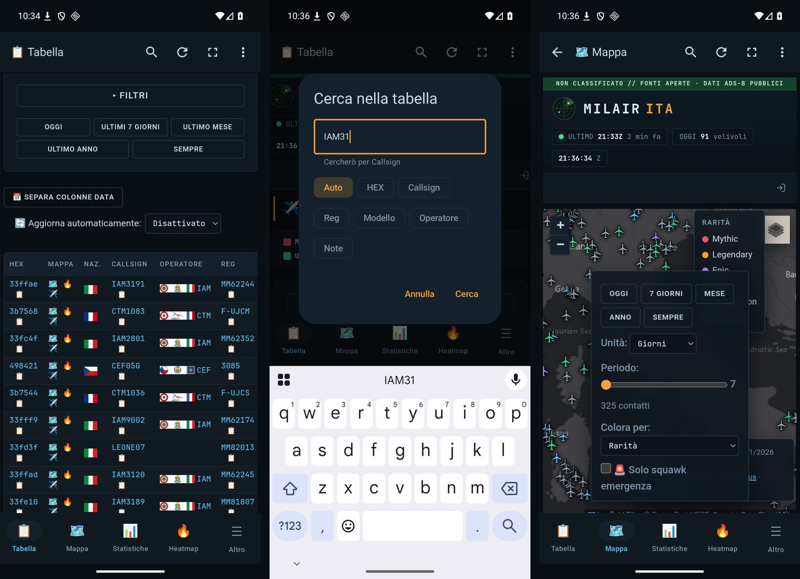

# MilAir ITA per Android

App per telefono e tablet Android (10 o successivo) che rende più comodo usare un'installazione di MilAir ITA.
È un client nativo "ibrido": le pagine restano quelle del server, l'app aggiunge navigazione nativa, doppio
pannello sui tablet, notifiche degli alert e le comodità che il browser non dà. **Non richiede modifiche al server.**

**Download:** [`MilAir_ITA-Android-1.1.apk`](MilAir_ITA-Android-1.1.apk) · 3,4 MB · versione 1.1 (25/11/2026)
· SHA-256 `a796a0a42334edcdda1cd5ed4fb49f5d88c14f9d69fb66f1dfb3cee635997082`

## Cosa fa

- **Navigazione nativa**: barra in basso sul telefono, barra laterale sul tablet. Le voci si leggono dal menu del sito, quindi l'app segue da sola le pagine disponibili e il ruolo dell'utente (pubblico, collaboratore, admin).
- **Doppio pannello sui tablet**: tabella a sinistra, mappa/heatmap/statistiche/alert a destra, con divisore trascinabile. 🗺️ e 🔥 dalla tabella aprono a destra; i link della mappa verso la tabella aprono a sinistra.
- **Modalità monitor**: schermo intero e sempre acceso, per tenere la mappa aperta su un tablet.
- **Notifiche degli alert** in background (ogni 15, 30 o 60 minuti) tramite `alerts_count.php`, con il numero sul tab Alert. Servono un account collaboratore o admin.
- **Ricerca rapida** per HEX, callsign, matricola (MM…), modello, operatore o note: apre la tabella già filtrata e riconosce da sola HEX e matricole.
- **Comodità sul telefono**: filtri della tabella chiusi all'apertura (restano aperti se ce n'è uno attivo), pulsanti rapidi compatti, pull-to-refresh fuori dalle mappe.
- **Export CSV** nella cartella Download (con la sessione dell'app), **stampa / salva in PDF** della pagina, link esterni (FlightRadar24, JetPhotos…) in una scheda del browser.
- **Sicurezza**: solo HTTPS (accetta anche una CA privata installata su Android), sblocco opzionale con impronta o PIN, nessuna password salvata dall'app: il login si fa nella pagina del sito, anche con il password manager.
- Tema scuro con i colori del tema «sala operativa», zoom del testo, scorciatoie dall'icona (Mappa, Oggi, Alert), ripresa dall'ultima pagina.

## Installazione

1. Scarica l'APK sul dispositivo e aprilo; Android chiede di consentire l'installazione da quella fonte.
2. Al primo avvio inserisci l'indirizzo della cartella di MilAir ITA, ad esempio `https://server.esempio.it/milair_ita/`. L'app verifica che `login.php` risponda.
3. Per gli alert accedi con un account collaboratore o admin e consenti le notifiche.

Da computer, con il debug USB o wireless attivo: `adb install -r MilAir_ITA-Android-1.1.apk`.

L'APK è firmato con una chiave di sviluppo: per aggiornarlo basta installare sopra la versione nuova pubblicata qui.

## Versioni

- **1.1** (25/11/2026): voci di navigazione dal menu del sito, tema scuro allineato al sito, filtri compatti sul telefono, correzioni.
- **1.0** (25/11/2026): prima versione.
